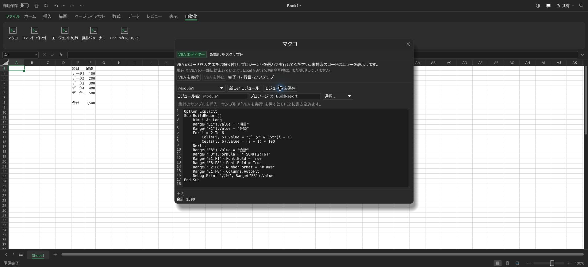

<p align="center">
  <a href="https://getartcraft.com/">
    <picture>
      <source media="(prefers-color-scheme: dark)" srcset="docs/brand/artcraft-logo-white.svg">
      
    </picture>
  </a>
</p>

<p align="center">
  
</p>

<h1 align="center">GridCraft</h1>

<p align="center">
  <b>Rustで開発する表計算アプリ。日本語で使うための改良と、Excel互換マクロの開発を進めています。</b>
</p>

<p align="center">
  上流GridCraftは、独立実装によるオープンソースの表計算アプリです。macOS・Windows・Linux・BSDと、WebAssemblyによるブラウザ版があります。<br>
  <i>原作：ArtCraftチームとGridCraftの貢献者。このリポジトリは非公開の改変版です。</i>
</p>

<p align="center">
  
  
  
  
  <br>
  <a href="https://sonarcloud.io/project/overview?id=storytold_gridcraft"></a>
  <a href="https://coderabbit.ai"></a>
</p>

<p align="center">
  <a href="https://discord.gg/artcraft"></a>
</p>

<p align="center">
  <a href="https://getartcraft.com/apps/gridcraft"><b>上流GridCraftの紹介</b></a> ·
  <a href="https://getartcraft.com/">ArtCraft</a> ·
  <a href="https://getartcraft.com/apps">上流のアプリ一覧</a>
</p>

このリポジトリは **[atatakeisi/gridcraft](https://github.com/atatakeisi/gridcraft) の非公開の独自開発版** です。上流は [storytold/gridcraft](https://github.com/storytold/gridcraft)。上のコミュニティ・紹介・品質バッジは上流に関するもので、この改変版の公開配布や保証を示しません。

**開発段階はalphaです。Excel VBAの完全互換が最終要件ですが、現在は部分実装で未達です。** 変更点・検証記録は [PROJECT_STATUS.md](PROJECT_STATUS.md)、マクロの対応範囲は [docs/vba-compatibility.md](docs/vba-compatibility.md) を参照してください。

<br>

<p align="center">
  
  <br><sub><b>四半期の売上ダッシュボード</b>：集計行、条件付き書式、スパークライン、2つのグラフ。GridCraftのコマンドとサンプルブックから作成した画面です。</sub>
</p>

> [!NOTE]
> **ArtCraftは、さまざまな分野の作り手が集まる上流プロジェクトのコミュニティです。**
> 絵画、写真、映像、イラスト、デザイン、アニメーションなど、経験を問わず参加できます。
> [上流のDiscord](https://discord.gg/artcraft)では作品や改善案を共有しています。

<p align="center">
  <a href="#画面例">画面例</a> ·
  <a href="#主な機能と制限">機能と制限</a> ·
  <a href="#ローカルで起動する">起動方法</a> ·
  <a href="#aiや外部ツールから操作する">AIからの操作</a> ·
  <a href="#開発構成">開発構成</a> ·
  <a href="#開発状況">開発状況</a> ·
  <a href="#上流のcrafting-apps">上流の関連アプリ</a> ·
  <a href="#ライセンス由来商標">ライセンスと由来</a>
</p>

## 日本語版の画面



日本語の「自動化」→「マクロ」→「VBA エディター」からコードを貼り付けて実行した、現在の開発版の画面です。

## 画面例

以下は上流で作成された英語UIのサンプル画面です。サンプルブックの内容や画面言語を、日本語版の現在の表示と混同しないようにしてください。

<table>
<tr>
<td width="50%" valign="top"><p align="center"><sub><b>書式設定。</b> 会計書式、セルスタイル、条件付き書式、見出しの固定、横棒グラフ。</sub></p></td>
<td width="50%" valign="top"><p align="center"><sub><b>数式。</b> 多数のワークシート関数、動的配列、LET・LAMBDA、テーブルの構造化参照。</sub></p></td>
</tr>
<tr>
<td width="50%" valign="top"><p align="center"><sub><b>ダークモードと挿入タブ。</b> テーブル、グラフ、スパークライン、画像、図形、リンク、コメント。</sub></p></td>
<td width="50%" valign="top"><p align="center"><sub><b>ピボットテーブル。</b> フィールド一覧、フィルター、レイアウト、日付グループ化、XLSXでの保存・読込。</sub></p></td>
</tr>
<tr>
<td width="50%" valign="top"><p align="center"><sub><b>グラフ。</b> 複数のグラフ形式、グラフデザインタブと書式設定ペイン。選択すると元データを強調します。</sub></p></td>
<td width="50%" valign="top"><p align="center"><sub><b>改ページプレビュー。</b> 印刷設定、PDF出力、印刷。</sub></p></td>
</tr>
</table>

## 主な機能と制限

- **表の編集と書式。** リボン、数式バー、シートタブ、コピー・貼付け、オートフィル、テーブル、条件付き書式、入力検証、並べ替え・フィルターを備えます。
- **計算と分析。** 依存関係に基づく再計算、動的配列、LET・LAMBDA、構造化参照、ピボットテーブル、各種グラフを実装しています。機能が存在することとExcelと同じ結果になることは区別し、[関数](docs/function-parity.md)・[グラフ](docs/chart-parity.md)・[互換性評価](docs/target-app-parity.md)で制限を管理します。
- **ファイル。** XLSXを基本に、CSV・TSVを読み書きできます。旧形式の `.xls` は値・数式・数値書式などの部分読込です。[XLSB](docs/xlsb-import.md)・[ODS](docs/ods-import.md)も部分読込で、完全な変換ではありません。[セル内画像](docs/cell-pictures.md)にも対応します。複雑なブックの未対応情報が保存時に失われることがあります。
- **動作基盤。** コピーオンライトによる履歴、増分再計算、表示範囲だけを描画するグリッドを使います。大規模データでの性能と安定性は引き続き検証対象です。
- **日本語。** 日本語UI・セル表示・入力の改良を進めています。WebのフォントとIMEの確認範囲は [日本語対応の記録](docs/web-japanese.md)を参照してください。ネイティブ版とWeb版で使えるフォントは異なります。

### VBAマクロの現在の状態

**Excelで作ったVBAマクロの完全互換は、開発の最終要件です。現在の部分実装を完成版とは扱いません。**

マクロ画面のVBAエディタでソースを入力・貼付けし、対応する `Sub` を実行・停止できます。セル操作、集計、基本的な書式・グラフ操作の一部を扱い、エラー行と出力を表示します。成功時にまとめて反映し、停止・失敗時は途中のブック変更を破棄します。読込ブックに含まれるマクロや保存ソースの実行には、明示的な信頼操作が必要です。

**「モジュールを保存」は、編集ソースをGridCraft独自のmetadataへ保存します。Excelの `vbaProject.bin` を書き換えたり生成したりする機能ではありません。** 元のVBA projectは別に保持し、`.xlsm` / `.xltm` へ保存する場合に引き継ぎます。編集内容がそのままExcelで実行可能なマクロになるわけではありません。

引数・Function・ByRef、クラス、イベント、UserForm、外部連携、Windows固有機能、VBA projectの書戻しなどは未対応です。実ExcelコーパスとExcelでの出力確認も未実施です。対応表と制限は [VBA互換性](docs/vba-compatibility.md)を参照してください。

## 表示言語

この独自開発版は日本語を標準にしています。ネイティブ版は日本語で起動し、Web版は日本語フォントが利用できるビルドで日本語を初期表示します。以前に選んだ言語が保存されている場合は、その選択を使います。

Web版を明示的に日本語で開くにはURLへ `?lang=ja`（他の指定がある場合は `&lang=ja`）を付けます。画面の「表示」→「表示言語」で英語などにも切り替えられます。日本語フォントを含まないWebビルドは英語へフォールバックします。VBAの構文・数式名・識別子・入力したデータはそのまま保持します。詳細な実行時診断など、一部には英語が残ります。

## ローカルで起動する

このMacではRustとWasmターゲット、ローカルTrunkを準備済みです。ほかの環境では `Cargo.toml` のRust要件と [Web配信手順](packaging/web/README.md)を確認してください。以下は `gridcraft` ルートから実行します。

### 生成済みのWeb版を開く

[PROJECT_STATUS.md](PROJECT_STATUS.md)にある使用中の出力名を確認し、次の `dist/使用する出力名` を実際のフォルダ名に置き換えます。古い出力には最新ソースの変更が含まれません。すでに8771番で起動中なら、既存のタブを使います。

```sh
python3 -u -m http.server 8771 --bind 127.0.0.1 --directory "dist/使用する出力名"
```

ブラウザで [売上サンプル](http://127.0.0.1:8771/?sample=sales&lang=ja)を開きます。空白ブックは `http://127.0.0.1:8771/`、WebGL2で比較する場合は `?sample=sales&webgl` を使います。これはこのMac内だけの開発URLです。

### Web版をソースから再ビルドする

導入済みTrunkは `../.tools/trunk-0.22.0/trunk` です。環境変数の変更は不要です。`web-ja-new` は未使用の出力名に置き換え、既存の出力を上書きしないでください。

```sh
cd apps/gridcraft-web
../../../.tools/trunk-0.22.0/trunk --skip-version-check serve --dist ../../dist/web-ja-new
```

ブラウザのファイル選択・ドロップでブックを開き、保存は利用可能なブラウザAPIに応じて保存ダイアログまたはダウンロードを使います。Web版のファイル保存・再読込は、VBAエディタ内でのソース保存とは別に確認が必要です。

### ネイティブ版と開発確認

```sh
cargo run --release -p gridcraft
cargo run --release -p gridcraft -- --sample sales
cargo run --release -p gridcraft -- book.xlsx
cargo xtask ci
```

開発規約は [AGENTS.md](AGENTS.md)、AIの役割分担は [AI_TEAM_GUIDE.md](AI_TEAM_GUIDE.md)を参照してください。この作業環境では、ファイル削除・ディレクトリ上書き・パッケージ削除・環境変数変更には利用者の明示許可が必要です。

### キーボード操作とログ

Windows・Linux・BSDでは左Altを押して離す、各環境ではF10を押すと、対応するリボン項目のキー操作を開始できます。macOSでは必要に応じてFn+F10を使います。文字編集中・ダイアログ操作中は開始せず、ブラウザやOSに予約されたキーは使えない場合があります。

| キー操作 | 動作 |
|---|---|
| `H A L` / `H A C` / `H A R` | 左揃え / 中央揃え / 右揃え |
| `H V S` または従来の `E S` | 形式を選択して貼付け |
| `H O I` または従来の `O C A` | 選択列の幅を自動調整 |

貼付け画面ではT/V/F/Cで書式・値・数式・コメント、Eで行列の入替えを選び、Enterで適用、Escapeで取消します。Escapeでキー表示を1段戻し、Alt/F10でも終了できます。対応範囲は一部のHome項目から拡張中です。

ネイティブ版のログは標準エラーと設定フォルダ内の `logs/gridcraft.log` に出力します。macOSは `~/Library/Application Support/GridCraft/logs`、Linux・BSDは通常 `~/.config/gridcraft/logs`、Windowsは `%APPDATA%\GridCraft\logs` です。起動ごとに過去2回分を保持し、各ログは16MiBで打ち切ります。既存の `XDG_CONFIG_HOME`、`RUST_LOG`、`GRIDCRAFT_NO_PREFS` 設定がある場合はその設定に従います。調査のために環境変数を変える場合も、この環境の確認ルールを守ってください。

表示言語・ローカライズした数式入力の扱いは [数式入力の説明](docs/formula-input.md)を参照してください。ブック保存やプログラム向けAPIでは標準の英語構文を使います。

## AIや外部ツールから操作する

MCP・CLI・ネイティブ版の制御チャネルから、ブック操作コマンドを呼び出せます。以下は操作例で、AI同士の自動会話・自動送信を行うものではありません。

```sh
gridcraft-cli mcp
gridcraft-cli mcp --connect 7979
gridcraft-cli eval '=XLOOKUP("b",{"a","b"},{1,2})'
gridcraft-cli run --sample budget --cmd 'home.bold={"range":"B4:F4"}' --out budget.xlsx
gridcraft-cli cat budget.xlsx --range B4:F15
gridcraft-cli commands --search chart
```

ネイティブ版の制御チャネルを使う場合は、起動時に `--control 7979` を付けます。MCPには `read_range`、`write_range`、`set_cell`、`evaluate_formula`、`format_range`、`insert_chart`、`execute_command` などがあります。詳細は [MCP](docs/mcp.md)、[CLI](docs/cli.md)、[制御プロトコル](docs/control-protocol.md)を参照してください。

## 開発構成

計算・操作エンジンとUIを分離したCargo workspaceです。`cargo xtask layers` で依存方向を検査します。egui UIは交換可能な別crateです。

| 層 | 主なcrateと役割 |
|---|---|
| L0 | `core`：セル位置・値・エラー・日付、`numfmt`：数値書式 |
| L1 | `formula`：数式の解析・参照調整、`functions`：関数 |
| L2 | `model`：ブック・シート・セル・書式、`calc`：依存計算・動的配列、`xlsx`：ファイル読書き |
| L3 | `chart`：UIに依存しないグラフ描画 |
| L5 | `engine`：セッション・コマンド・履歴・ファイル操作・部分VBA実行 |
| L6 | `ui-egui`：共通UI・制御チャネル、`mcp`：MCPサーバー |
| L7 | `apps/gridcraft`、`apps/gridcraft-cli`、`apps/gridcraft-web` |

詳細は [構成](docs/architecture.md)、アセットの由来は [ATTRIBUTION.md](ATTRIBUTION.md)、上流の配布作成手順は [リリース手順](docs/release-playbook.md)を参照してください。

## 開発状況

**alpha段階です。** 基本的な表編集・計算・分析・保存の機能がありますが、Excelとの互換性、実ファイルでの信頼性、大規模ブック、文字表示などに課題があります。過去の関数数・完成率は測定範囲の異なる参考値であり、この改変版での完全互換や動作保証を意味しません。

[ROADMAP.md](ROADMAP.md)に全体方針、[docs/gaps.md](docs/gaps.md)に課題、[PROJECT_STATUS.md](PROJECT_STATUS.md)にローカル検証結果を記録します。VBAは完全互換を目指して段階的に開発中です。

## 上流版のダウンロード

**この非公開の独自開発版の改変内容を含む公開配布は案内していません。** [上流の最新版](https://github.com/storytold/gridcraft/releases/latest)・[上流のリリース一覧](https://github.com/storytold/gridcraft/releases)は、ArtCraft側のGridCraftです。この独自開発版の日本語・VBA変更が入っているとは限りません。

上流の配布形式には次のものがあります。各リリースの実ファイルと `SHA256SUMS.txt` を確認してください。署名・公証の説明も上流の成果物に対するもので、この独自開発版のローカルビルドには引き継がれません。

| 環境 | 上流で用意する形式 |
|---|---|
| Windows | x64・arm64・x86のMSIとportable ZIP。インストーラー・実行ファイルは上流でコード署名 |
| macOS | Apple silicon / Intel共通のDMGとCLI ZIP。上流で署名・公証 |
| Linux | x86_64・aarch64のAppImage、Flatpak、deb、rpm、tar.gz |
| FreeBSD | x86_64のtar.gz |
| Web | `gridcraft-web-<version>.zip` の静的サイト |

WindowsではDirectX 12を基本に、GPUやドライバーの条件によってOpenGLへ切替える経路があります。AMDのOpenGL、IntelのVulkan等で報告された起動問題もあるため、起動に失敗する場合はログを確認してください。`WGPU_BACKEND` や `WGPU_DX12_COMPILER` による診断設定もありますが、ここでは環境変数を変更する手順は実行しません。

## 上流のCrafting Apps

上流GridCraftは、[ArtCraft](https://getartcraft.com/)チームの **Crafting Apps** の1つです。各アプリはRustで独立して開発された、オープンソースの制作ツールです。下のリンクは上流の紹介です。

| | アプリ | 用途 | ソース | 紹介 |
|:-:|---|---|---|---|
|  | **PhotoCraft** | 画像編集、レイヤー、マスク、文字、PSD | [GitHub](https://github.com/storytold/photocraft) | [紹介](https://getartcraft.com/apps/photocraft) |
|  | **VectorCraft** | ベクターイラスト | [GitHub](https://github.com/storytold/vectorcraft) | [紹介](https://getartcraft.com/apps/vectorcraft) |
|  | **FilmCraft** | 映像編集、色調整、音声 | [GitHub](https://github.com/storytold/filmcraft) | [紹介](https://getartcraft.com/apps/filmcraft) |
|  | **LightCraft** | 写真管理とRAW現像 | [GitHub](https://github.com/storytold/lightcraft) | [紹介](https://getartcraft.com/apps/lightcraft) |
|  | **PdfCraft** | PDFの閲覧・整理・保護 | [GitHub](https://github.com/storytold/pdfcraft) | [紹介](https://getartcraft.com/apps/pdfcraft) |
|  | **EffectCraft** | モーショングラフィックスと映像効果 | [GitHub](https://github.com/storytold/effectcraft) | [紹介](https://getartcraft.com/apps/effectcraft) |
|  | **DesignCraft** | ページレイアウトと出版 | [GitHub](https://github.com/storytold/designcraft) | [紹介](https://getartcraft.com/apps/designcraft) |
|  | **GridCraft** | **表計算とデータ処理（この独自開発版の元プロジェクト）** | [GitHub](https://github.com/storytold/gridcraft) | [紹介](https://getartcraft.com/apps/gridcraft) |

[**ArtCraft**](https://getartcraft.com/)では、画像・映像制作のAIスタジオも提供されています。


<br>

<p align="center">
  <a href="https://discord.gg/artcraft"></a>
</p>

<h3 align="center">上流コミュニティの紹介</h3>

<p align="center">
  絵画、写真、映像、イラスト、デザインなど、さまざまな作り手が参加しています。
  作品、使い方、改善案は上流のDiscordで共有できます。この独自開発版への対応や支援を上流が保証するものではありません。
</p>

<p align="center">
  <a href="https://discord.gg/artcraft"><b>discord.gg/artcraft</b></a> ·
  <a href="https://getartcraft.com/">getartcraft.com</a> ·
  <a href="https://getartcraft.com/apps">上流のアプリ一覧</a> ·
  <a href="https://getartcraft.com/apps/gridcraft">上流GridCraft</a>
</p>

## ライセンス・由来・商標

GridCraftは [MIT](LICENSE-MIT) または [Apache-2.0](LICENSE-APACHE) のデュアルライセンスです。利用者がいずれかを選べます。Copyright (c) 2026 ArtCraft Team and the GridCraft contributors。必要な告知は [NOTICE](NOTICE)にあります。

同梱するアイコン・画像などのアセットには、それぞれのライセンスが適用されます。作者・入手元・条件は [ATTRIBUTION.md](ATTRIBUTION.md)を参照してください。UIアイコンはコードで描画した独自のもので、READMEのサンプルブックと画面画像はGridCraft自身で作成されています。上流由来の画像は既存のまま保持しています。

フォントのソースファイルはこのリポジトリへ追加しません。ネイティブ版はシステムフォントを使い、Web版は外部の `craft-fonts` からBIZ UDPGothic Regularを任意で埋め込めます。そのフォントにはSIL Open Font License 1.1が適用され、埋め込んだ配布物にも告知が必要です。[Web配信手順](packaging/web/README.md)に詳述しています。

**ArtCraftの名称・ワードマーク・ロゴはArtCraft Teamの商標であり、MIT / Apache-2.0の対象ではありません。** [`docs/brand/`](docs/brand/)のアセットには [`LICENSE-brand.txt`](docs/brand/LICENSE-brand.txt)が適用されます。許可された文脈で、元の形を変更せず、上流のGridCraftを示すためにだけ使用できます。**改変版を配布・公開する場合は、ArtCraftの商標画像を除去または独自のものへ置き換え、ArtCraft製品として表示してはいけません。** 上流へ変更提案するためだけのforkには原文の例外があります。この非公開の独自開発版が上流の公認・支援を受けているという意味ではありません。

<br>

<p align="center">
  <a href="https://getartcraft.com/"></a><br>
  <sub>元プロジェクトは <a href="https://getartcraft.com/">ArtCraft</a> チームとコミュニティによるものです。</sub>
</p>
